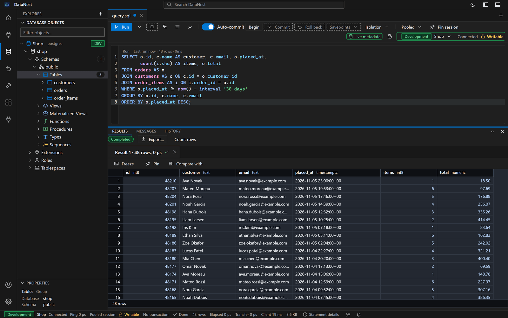

<h1>
  <picture>
    <source media="(prefers-color-scheme: dark)" srcset="assets/datanest-logo-dark.svg" />
    
  </picture>
</h1>

A database workbench for PostgreSQL, MySQL, MariaDB, SQLite, SQL Server, Oracle, DuckDB, MongoDB, CockroachDB,
YugabyteDB and Amazon Redshift: SQL that knows your schema, a results grid built for real data, ER diagrams, schema
migrations and server tools, in VS Code or as a desktop app for Windows, macOS and Linux.

**[dmitrypost.github.io/datanest-app](https://dmitrypost.github.io/datanest-app/)**

## Get DataNest

- **VS Code**: the DataNest extension (`datanest.datanest`) on the Visual Studio Marketplace and Open VSX once it is
  published there, and as a `.vsix` for each platform in the [releases](https://github.com/dmitrypost/datanest-app/releases).
- **Desktop**: Windows (`.msi` or `-setup.exe`), macOS (`.dmg`, for Apple silicon and Intel) and Linux (`.deb` or
  `.rpm`), in the [releases](https://github.com/dmitrypost/datanest-app/releases).

DataNest is in preview, and the builds are not code-signed yet.

## Feedback

Bugs, questions and ideas are welcome in the [issues](https://github.com/dmitrypost/datanest-app/issues).

## This repository

This is DataNest's public home: the site, served by GitHub Pages from `main`, the releases and the issue tracker.
DataNest's source is not public; its release workflow publishes each version's packages here.

- `index.html`, `styles.css` and `site.js` are the whole site, with no build step. `site.js` lists the newest release's
  packages from the GitHub API, so a release needs no change here.
- `screens/` holds the screenshots, drawn from the real workbench by DataNest's `scripts/showcase-screens.mjs`. The PNGs
  also illustrate the extension's Marketplace page.
- **When the extension is on a store**, turn it on in `STORES` at the top of `site.js`; until then the site points to the
  `.vsix` packages.

## License

DataNest is free to use; see [LICENSE.md](LICENSE.md).
